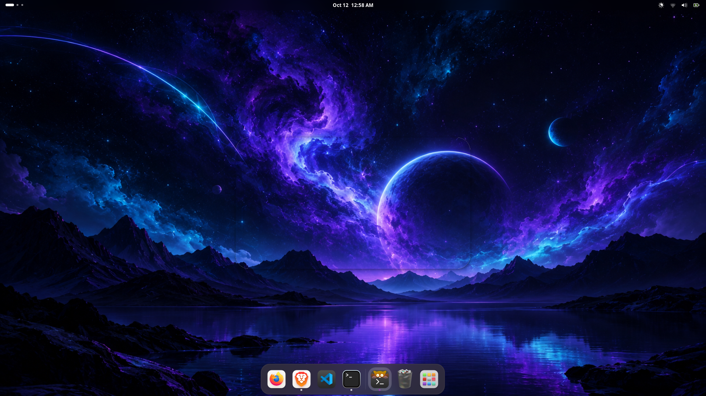
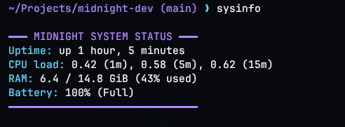
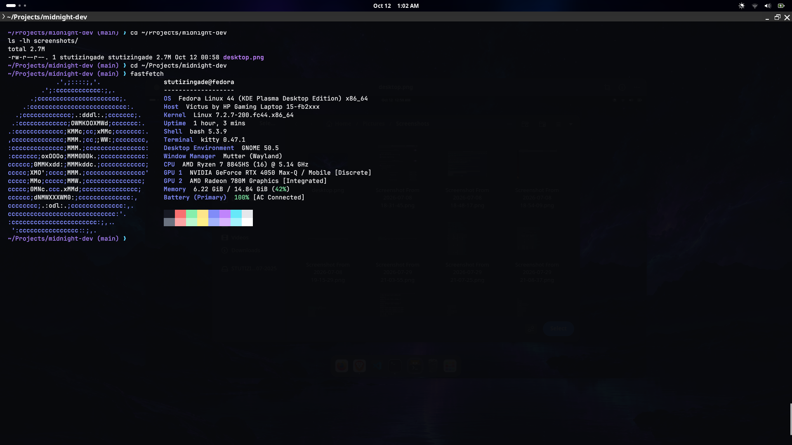
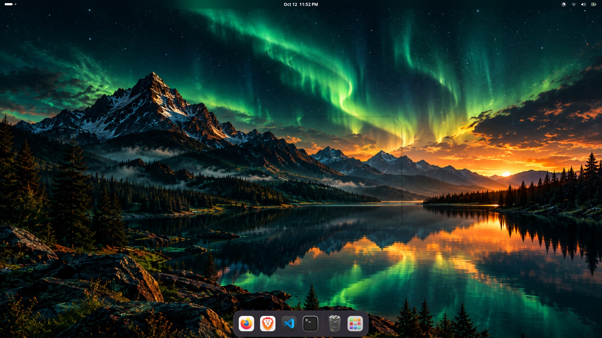

# Midnight Dev

A customized, keyboard-driven developer workstation built on Fedora Linux and GNOME.

## Features
- Unified dark violet and cyan theme
- Developer terminal configuration
- Keyboard-driven workflow
- CPU, RAM and battery monitoring
- Wayland screenshots
- Portable dotfiles and setup scripts

## Tech Stack
- Fedora Linux
- GNOME / Wayland
- Kitty
- Fastfetch
- Bash
- Git and GNU Stow

## Screenshots

### Desktop


### System Status


### Terminal — Fastfetch


## Installation
Installation instructions will be added as the setup is completed.

## Keyboard Shortcuts
Documented as shortcuts are configured.

## GNOME Workspace Shortcuts

Run `./scripts/configure-workspaces.sh` to configure four workspaces.

| Shortcut | Action |
|---|---|
| Super + 1–4 | Switch to workspace 1–4 |
| Super + Shift + 1–4 | Move the active window to workspace 1–4 |

Suggested workspace roles:

- Workspace 1: Coding
- Workspace 2: Terminal and development servers
- Workspace 3: Research and documentation
- Workspace 4: Monitoring and debugging

The script uses GNOME's `gsettings` and is intended for GNOME desktop sessions.

## Bonus Feature: Dynamic Theme Switcher

Midnight Dev includes a dynamic theme switcher that lets you change your desktop wallpaper and Kitty terminal color palette with one command.

### Available Themes

- **Midnight Space** — A dark space-inspired theme with cyan and violet accents.
- **Midnight Violet** — A deeper violet theme with lavender and cyan accents.

### Usage

Switch to Midnight Space:

```bash
midnight-theme space
```

Switch to Midnight Violet:

```bash
midnight-theme violet
```

The script updates the GNOME desktop wallpaper and saves the corresponding Kitty color palette. Open a new Kitty window or restart Kitty to apply the terminal colors.

### Implementation

- Wallpapers are stored in `wallpapers/`.
- Kitty color palettes are stored in `configs/kitty/`.
- The theme-switching script is located at `scripts/midnight-theme.sh`.
- The installer installs the theme palettes and makes the theme-switching command available as `midnight-theme`.

This feature adds quick visual customization without requiring manual wallpaper or terminal configuration changes.

### Midnight Green

A forest-inspired dark theme featuring emerald green, teal, and amber accents.

Switch to this theme with:

    midnight-theme green

The theme switcher updates the GNOME desktop wallpaper and Kitty terminal palette.

## Midnight Green Desktop


