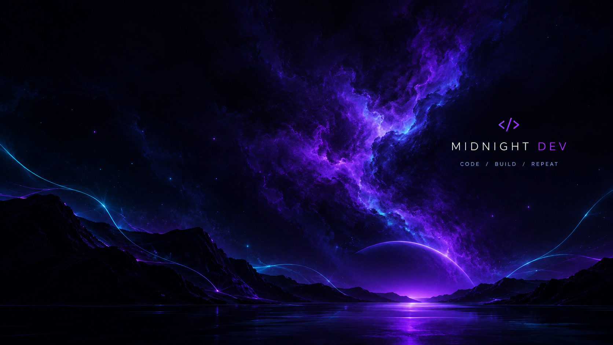

# 🌙 Midnight Dev

**A personalized Fedora Linux desktop built for developers who love dark aesthetics, keyboard-driven workflows, and a terminal-first environment.**

Midnight Dev transforms a standard Fedora GNOME desktop into a coordinated developer workspace. It combines three custom color themes, a personalized Kitty terminal, Fastfetch system information, GNOME workspace shortcuts, and lightweight system-monitoring scripts.

The goal is to create a desktop that looks consistent, feels comfortable to use, and keeps essential developer tools close at hand.

## ✨ Features

- 🎨 **Three custom themes:** Midnight Space, Midnight Violet, and Midnight Green.
- 🖥️ **Kitty terminal customization:** Matching color palettes for all three themes.
- ⚡ **Fastfetch integration:** A personalized system information display.
- 📊 **System monitoring:** View uptime, CPU load, RAM usage, and battery information when available.
- ⌨️ **Keyboard-driven workflow:** Shortcuts for switching workspaces and moving windows.
- 🖼️ **Custom wallpapers:** Three wallpapers coordinated with the project themes.
- 🔄 **One-command theme switching:** Change the terminal palette and desktop wallpaper.
- 🧰 **Developer aliases:** Quick commands for Git, project navigation, and system utilities.
- 🛡️ **Installation and rollback scripts:** Back up existing configuration files and restore tracked files during uninstallation.

## 🎨 Themes

Midnight Dev includes three visual themes, each with a matching Kitty palette and desktop wallpaper.

| Theme | Description | Palette |
|---|---|---|
| Midnight Space | A cool, deep-night aesthetic | `midnight-space.conf` |
| Midnight Violet | Dark tones with violet accents | `midnight-violet.conf` |
| Midnight Green | Dark tones with green accents | `midnight-green.conf` |

### 🌌 Midnight Space


A deep, space-inspired look designed for a calm and focused development environment.

### 💜 Midnight Violet



A dark theme with violet accents for a distinctive, modern desktop aesthetic.

### 💚 Midnight Green


A dark green palette designed for a clean, understated developer workspace.

The theme switcher updates the current Kitty palette, changes the desktop wallpaper, and enables GNOME's dark color preference.

## 📸 Screenshot Gallery

The following screenshots demonstrate the desktop appearance, terminal customization, and system-monitoring features.

### 1. Desktop Overview


### 2. Midnight Green Desktop


### 3. System Status Monitor


### 4. Terminal and Fastfetch


## 🖥️ Desktop Environment

Midnight Dev is designed for Fedora Linux using GNOME.

| Component | Purpose |
|---|---|
| Fedora Linux | Operating system |
| GNOME | Desktop environment and workspace management |
| Kitty | Terminal emulator |
| Fastfetch | System information display |
| Bash | Shell aliases and prompt integration |
| Bash scripts | Theme switching, system monitoring, installation, and rollback |

The final appearance may also depend on the GNOME theme, extensions, wallpaper, and settings installed on the system.

## ⌨️ Keyboard Shortcuts

The project uses GNOME workspace shortcuts to make multitasking easier.

| Shortcut | Action |
|---|---|
| `Super + 1` | Switch to workspace 1 |
| `Super + 2` | Switch to workspace 2 |
| `Super + 3` | Switch to workspace 3 |
| `Super + 4` | Switch to workspace 4 |
| `Super + Shift + 1` | Move the active window to workspace 1 |
| `Super + Shift + 2` | Move the active window to workspace 2 |
| `Super + Shift + 3` | Move the active window to workspace 3 |
| `Super + Shift + 4` | Move the active window to workspace 4 |

`Super` is usually the Windows key on a standard keyboard.

To configure the workspace shortcuts, run:

```bash
~/.local/bin/configure-workspaces.sh
```

Review the shortcuts in GNOME Settings → Keyboard if they differ from the table above.

## 🚀 Installation

### Requirements

- Fedora Linux with GNOME
- Bash
- Git
- Kitty
- Fastfetch

Install the required applications if they are not already available:

```bash
sudo dnf install git kitty fastfetch
```

### 1. Clone the repository

```bash
git clone https://github.com/stuti3333/midnight-dev.git
cd midnight-dev
```

### 2. Install Midnight Dev

```bash
./install.sh
```

The installer checks for required applications and project files, backs up tracked configuration files before replacing them, installs terminal and Fastfetch configurations, installs helper scripts, and copies wallpapers without overwriting existing files.

### 3. Reload Bash

Open a new Bash terminal or run:

```bash
source ~/.bashrc
```

### 4. Configure workspace shortcuts (optional)

```bash
~/.local/bin/configure-workspaces.sh
```

Review the resulting shortcuts in GNOME Settings before relying on them.

## 🎨 Switching Themes

After installation, use `midnight-theme` followed by a theme name.

**Midnight Space**

```bash
midnight-theme space
```

**Midnight Violet**

```bash
midnight-theme violet
```

**Midnight Green**

```bash
midnight-theme green
```

The command changes the desktop wallpaper and selects the corresponding Kitty palette. Open a new Kitty window to see the updated terminal colors.

## 🎥 Screen Recording

Watch the project demonstration below:

[▶️ Watch Screen Recording](screenvid.mp4)


## 📊 System Monitoring

Run the system status script using:

```bash
midnight-status.sh
```

The script displays available system information, including:

- System uptime
- CPU load averages
- RAM usage and percentage
- Battery status, when battery information is available

The script is a lightweight command-line status report, not a continuously updating desktop panel.

See the [system status screenshot](screenshots/system-status.png).

## 🧰 Developer Aliases

Midnight Dev provides optional Bash aliases for common tasks.

| Alias | Purpose |
|---|---|
| `croot` | Navigate to the Git repository root, or fall back to the home directory |
| `gs` | Run `git status` |
| `gl` | Display a compact Git commit graph |
| `sysinfo` | Run the system status script |
| `update` | Refresh Fedora package metadata and install available updates |
| `ports` | Display listening and open TCP/UDP sockets |
| `cls` | Clear the terminal |
| `monitor` | Launch `btop`, if installed |

The `update` alias uses `sudo dnf upgrade --refresh`, which may request your password and update installed packages. The `monitor` alias is available only if `btop` is installed.

## 📁 Project Structure

```text
midnight-dev/
├── configs/
│   ├── kitty/
│   │   ├── kitty.conf
│   │   ├── midnight-space.conf
│   │   ├── midnight-violet.conf
│   │   └── midnight-green.conf
│   └── fastfetch/
│       └── config.jsonc
├── scripts/
│   ├── configure-workspaces.sh
│   ├── midnight-aliases.sh
│   ├── midnight-prompt.sh
│   ├── midnight-status.sh
│   └── midnight-theme.sh
├── wallpapers/
│   ├── midnight-space.png
│   ├── midnight-violet.png
│   └── midnight-green.png
├── screenshots/
│   ├── desktop.png
│   ├── midnight-green-desktop.png
│   ├── system-status.png
│   └── terminal-fastfetch.png
├── install.sh
├── uninstall.sh
└── README.md
```

## ♻️ Uninstallation

To restore backed-up configuration files and remove tracked files created by the installer, run this command from the cloned repository:

```bash
./uninstall.sh
```

The uninstaller validates the installation manifest and checks the required backups before proceeding. It then restores existing files and removes tracked files created by the installer.

**Important considerations:**

- Keep the installation manifest and backups until you no longer need rollback.
- Wallpapers are intentionally retained after uninstallation.
- GNOME wallpaper settings, keyboard shortcuts, themes, and extensions may require separate cleanup.
- Manually edited files and settings outside the installer's manifest may not be restored automatically.

## 🔒 Backup and Recovery

The installer stores its manifest and backup files under:

```text
~/.local/share/midnight-dev/
```

The manifest records which files existed before installation and which files were created by the installer. The uninstaller uses these records to determine what to restore or remove.

Keep this directory intact if you may need to roll back your configuration.

## 🛠️ Customization

You can adapt Midnight Dev to your preferences by:

- Editing Kitty settings in `configs/kitty/`.
- Adjusting the Fastfetch configuration in `configs/fastfetch/`.
- Replacing the wallpapers in `wallpapers/`.
- Modifying scripts in `scripts/` to add new workflow commands.
- Adding screenshots of new themes or desktop features.

Test any configuration changes before applying them to your everyday desktop.

## 🎯 Project Goals

Midnight Dev explores how Linux configuration files, shell scripting, terminal customization, and GNOME shortcuts can be combined to create a consistent and productive developer environment.

It is designed as a personal desktop customization project and a foundation that other developers can adapt to their own workflows.

## 📄 License

A license has not been specified in this repository. If you want others to reuse, modify, or redistribute the project, consider adding an appropriate `LICENSE` file.

---

**Built on Fedora Linux. Customized for focused development.**
